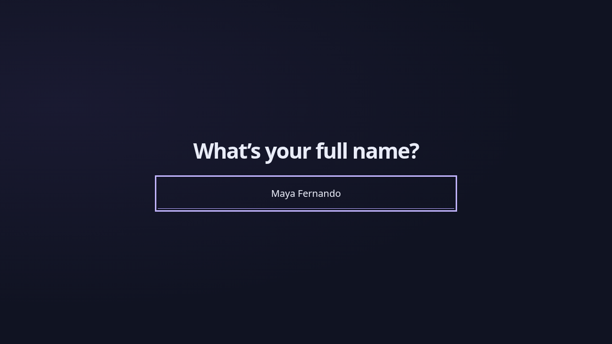

# LevelUp Results

A usable student results portal and teacher workspace, built with vanilla HTML/CSS/JavaScript, Node.js/Express and MongoDB. This branch extends the original MVP while preserving student/paper IDs and existing marks.



## MongoDB restored

`main` now uses the Node/Express + MongoDB implementation again. The Supabase edition remains on `feat/supabase-github-pages` and in Git history; its project/data have not been deleted. Its Pages deployment workflow is removed. GitHub Pages cannot host this backend: deploy to an HTTPS Node host/VPS using the instructions below.

Existing MongoDB data is preserved. Any records added in Supabase are not automatically copied back and must be reconciled separately before switching live writes. Retire the previous Pages/Supabase endpoint when switching live traffic so students do not use two different portals. The root `index.html` provides startup instructions; Express serves the actual application from `public/index.html`.

## Run locally

Requirements: Node.js **20.19+** (24 LTS recommended), npm, and MongoDB **7 or 8** running locally or an authenticated MongoDB Atlas database.

```bash
git clone --branch main https://github.com/nethsara-rahiru/Students-Results-Portals.git
cd Students-Results-Portals
npm ci
cp .env.example .env
openssl rand -hex 32
```

Put the generated secret into `SESSION_SECRET` in `.env`; set `MONGODB_URI` and `MONGODB_DB` as needed. Do not use the test secrets. Create the administrator interactively (the password is hidden and bcrypt-hashed):

```bash
npm run admin:set
npm run dev
```

Open **http://localhost:3000** for students and **http://localhost:3000/admin** for teachers. `npm start` runs without watch mode. `/health` checks database connectivity. No build step or external font/CDN dependency is required. To use another interface during development set `HOST=0.0.0.0`; keep the production application port private.

The optional `ADMIN_USERNAME` / `ADMIN_PASSWORD_HASH` variables seed an administrator only when that username does not exist. Use `npm run admin:set` to create or reset credentials; it revokes all existing sessions. Do not put plaintext passwords in `.env`.

## MongoDB setup

Install MongoDB Community using the official instructions for your OS, or create an Atlas cluster. For local development the default URI uses loopback port 27017. The configured database name defaults to `levelup_results` independently of the URI path.

For production, enable MongoDB authentication, use TLS for remote connections, and restrict MongoDB to loopback/private networking. In `mongosh`, authenticated as a database administrator, create an application user without placing the password in shell history:

```javascript
use levelup_results
db.createUser({user: 'levelup', pwd: passwordPrompt(), roles: [{role: 'readWrite', db: 'levelup_results'}]})
```

Use an appropriately URL-encoded password in `MONGODB_URI`, with `authSource=levelup_results`. Atlas users need equivalent access. Collections, indexes and new-collection JSON schema validators are created at startup. Existing MVP collections receive compatible field migrations and indexes without replacing IDs. Existing collection validators are left intact; application validation applies to every API write. Back up before upgrading, and stop old server processes during migration.

Collections: `students`, `classes`, `papers`, `marks`, `administrators`, `auditLogs`, `sessions`. Marks have a unique `(studentId, paperId)` index; administrator usernames and class names are unique. Duplicate student names are allowed and must use distinct class/profile labels. Internal ObjectIds, never names, identify marks.

## Teacher workflow

1. Sign in at `/admin`. Create classes, then students; assign a non-sensitive profile label to distinguish duplicate names. Edit a profile to deactivate/reactivate it or set an access code.
2. Create a paper with subject, grade, date, maximum and optional class. A draft column appears immediately in **Marks**. Use **Papers → Move left** to reorder spreadsheet columns and the student reveal together.
3. Enter marks in the spreadsheet. Changes save when leaving a cell. The status line reports saving, success or validation failures. Use **A** for absent, blank for no entered result, and **0** for an actual zero. Up to two decimal places are supported.
4. Click a cell; use Shift-click or Shift+arrows for ranges. Arrow keys, Tab and Enter navigate. Copy/paste TSV from Excel, use **Fill down** / Ctrl or ⌘+D, Delete to clear, and Undo/Redo / Ctrl or ⌘+Z. Undo history lasts until the grid is rebuilt by search, sorting, filtering or navigation. Batch pastes are limited to 2,000 cells and rejected before writing if any cell is invalid. Saving temporarily makes cells read-only.
5. Selection calculations show **SUM, AVERAGE, MAX, MIN, COUNT** for numeric cells. They are computed locally; formulas are never evaluated or stored as marks. No full Excel formula language or workbook import/export is claimed.
6. Verify marks, then explicitly choose **published** in the paper editor. **draft** and **unpublished** papers are hidden from student APIs. Editing an already published mark changes its visible value immediately; unpublish first if reviewing changes privately.
7. **Performance** shows normalized averages; **History** shows the latest 200 audit events with prior/new marks. Audit events remain in MongoDB beyond this display limit.

## Student experience and privacy

The landing page shows only a name prompt and textbox, without a card or form. Enter your full name and press Enter (or Go on a mobile keyboard) to look up your profile. Lookup never runs while typing. Names match after case/whitespace normalization; otherwise up to five similar names are offered. Confirm the profile, then its stable ID is remembered in `localStorage`. There is no ordinary account-switching control. Clearing browser storage can reset this convenience; it is **not authentication or a permanent identity lock**. On a shared device, clear site data between users.

In default `STUDENT_ACCESS_MODE=name`, anyone who knows or guesses a student's name **can see that student's published marks**. Rate limiting, limited profile fields, internal IDs, class filtering and explicit publication reduce disclosure; they do not make name lookup private. Only use this mode with informed consent for results approved for sharing. Similar-name suggestions reveal limited names/profile labels after submission. Never put sensitive identifiers in profile labels.

For confidential marks, set `STUDENT_ACCESS_MODE=code`, assign each student a distinct random access code of at least 8 characters via the profile editor, and restart. Prefer 16+ random characters; distribute codes privately outside this app. Only bcrypt hashes are stored. A valid code establishes a student-bound HTTP-only session; remembering an ID alone cannot fetch marks. Sessions expire after eight hours. Name/profile suggestions remain visible; use a separate authenticated identity system if even roster membership is confidential. Forgotten codes must be reset by a teacher.

Each valid published paper is revealed individually in spreadsheet order. The student clicks the paper, digits roll vertically and decelerate to the exact score. The final paper has an achievement, light effects and confetti, plus replay and all-results actions. Absent/blank results are skipped. Percentage-point comparisons use normalized percentages and refer explicitly to the previous paper; no unsupported personal-best claim is made. Reduced-motion preferences eliminate rolling transitions and confetti; Skip animation is also available.

## Security

- Mongo-backed sessions; session rotation on login; bcrypt password hashing; eight-hour HTTP-only, SameSite=Strict cookies (Secure in production).
- Synchronizer CSRF token on every state-changing API call, plus same-origin checks. Administrative APIs always require a teacher session.
- Helmet CSP/security headers, escaped UI text, bounded JSON bodies, Zod validation, safe API errors and rate limits (login 10/15min, lookup 25/15min, code attempts 15/15min, result reads 120/15min, overall API 1,200/15min per IP).
- Student APIs return one selected student's published, class-appropriate numeric results only. No student API returns the marks table.
- Audit logs cover login, student/class/paper edits, publication, reordering and old/new marks; passwords and access-code hashes are excluded from admin data and audit payloads.
- No credentials or `.env` are committed. Treat database dumps and logs as confidential.

## Tests and screenshots

```bash
npm test
npx playwright install chromium
npm run test:e2e
npm run format:check
npm audit --omit=dev
```

Tests launch an isolated real MongoDB process using `mongodb-memory-server`; the first run downloads MongoDB. Browser tests launch their own synthetic-data server at port 3100 and do not touch your configured database. Chromium may need OS libraries (`npx playwright install --with-deps chromium` on supported systems).

Verified in this delivery: **14 API integration tests and 5 Chromium end-to-end tests**, including exact/similar lookup, duplicates, admin auth, CSRF, CRUD, invalid/valid bulk marks, zero/absence/blanks, publishing/unpublishing, ordering, access codes, class boundaries, persistence, rate limits, spinner completion, single/multiple reveals, final celebration, reduced motion, keyboard interactions and mobile layouts. Production dependency audit: **0 reported vulnerabilities** at delivery. See [test report](docs/testing.md).

Screenshots use synthetic students: [welcome](docs/screenshots/welcome.png), [teacher spreadsheet](docs/screenshots/admin.png), [final reveal](docs/screenshots/final-result.png), [mobile](docs/screenshots/mobile.png).

## VPS deployment

1. Provision Node 24 LTS, MongoDB (or Atlas), Nginx and a domain/TLS certificate. Create a dedicated unprivileged `levelup` service user and place the checkout at `/opt/levelup`. Run `npm ci --omit=dev` as that user.
2. Configure `/opt/levelup/.env` with production database credentials and a fresh random session secret. Set `NODE_ENV=production`, `HOST=127.0.0.1`, `PORT=3000`, `TRUST_PROXY_HOPS=1` for the supplied single Nginx proxy, and the desired student access mode. Restrict `.env` to the service user (`chmod 600 .env`). Run `npm run admin:set` as that user.
3. Install [deploy/levelup.service](deploy/levelup.service) in `/etc/systemd/system/`, adjusting the Node executable path if needed. Run `sudo systemctl daemon-reload` then `sudo systemctl enable --now levelup`.
4. Adapt [deploy/nginx.conf](deploy/nginx.conf) to your domain and certificate paths. Obtain a certificate with Certbot using your usual Nginx/webroot flow, enable the config, run `sudo nginx -t`, then reload Nginx. HTTPS is required for production admin sessions. The proxy must overwrite forwarded headers; trust only the configured number of proxies.
5. Firewall public traffic to SSH, 80 and 443 only. Do not expose MongoDB or port 3000. Check `/health`, sign in, enter sample marks, verify publishing, then remove the sample data. Logs: `journalctl -u levelup`. No VPS was provisioned or deployed by this change.

Run one application instance for the supplied in-process IP rate limits. Multiple instances need a shared rate-limit store and coordinated writes before scaling. Deploy updates by backing up, stopping the service, pulling the reviewed branch/release, running `npm ci --omit=dev`, then restarting and checking health. Roll back code only after checking database migration compatibility.

## Backups and recovery

Schedule daily encrypted `mongodump` archives using MongoDB Database Tools. Keep credentials in a permission-restricted Database Tools config file, never shell arguments or committed scripts. For example, use `mongodump --config=/etc/levelup/mongodump.yml --db=levelup_results --archive=/secure/backups/levelup.archive --gzip`; ensure the installed tool's config contains the appropriate URI. Keep off-site copies, restrict permissions, rotate retention, and monitor failures. Include all application collections and audit logs. Back up before every upgrade.

Regularly test `mongorestore` to an **isolated** database/server and verify students, marks, ordering and publication with synthetic access. Do not point restore commands at the live database without a planned recovery window. After a real restore, delete restored `sessions` to revoke stale logins. A backup that has never been restored is not verified.

## Known limitations

- Name mode deliberately does not provide confidentiality; optional code mode is shared-secret access, without student account recovery or MFA.
- Spreadsheet calculations are selection summaries, not stored formulas. Very large rosters are not virtualized. Similar-name search ranks at most 2,000 candidates, and exact-name lookup presents at most 30 profiles; larger ambiguous rosters require teacher labels or data cleanup.
- Validated mark batches and audit inserts are separate MongoDB writes, without a cross-document transaction. A database outage midway can leave a partially persisted batch or a missing audit event. Avoid simultaneous teachers editing the same cells: concurrent writes use last-write-wins and have no conflict UI. Backups and the save/error indicator remain necessary.
- Existing collection schemas are not replaced automatically. Migrated MVP data should be reviewed before publication. Previously existing collection validators may require manual migration.
- Undo is local to the current grid, not a global database rollback. No offline editing, CSV/workbook file import, email delivery, or automatic backup scheduler.
- E2E verification covers Chromium, including mobile viewport simulation, not physical devices or every browser. No independent penetration test or formal accessibility certification has been performed.

## Source layout

- `server.js`: application factory, MongoDB setup/migrations, sessions, security and APIs.
- `public/app.js`: student and teacher screens; `sheet.js`: spreadsheet interactions; `reveal.js`: animation and evidence-based messages; `style.css`: responsive design.
- `scripts/admin.js`: local administrator provisioning/reset.
- `tests/`: isolated integration and browser tests; `deploy/`: VPS examples; `docs/`: architecture, verification and screenshots.
